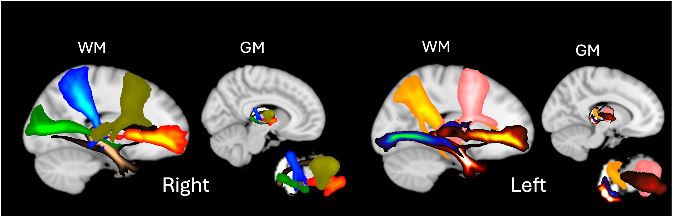
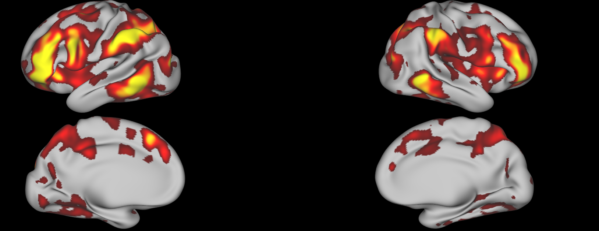
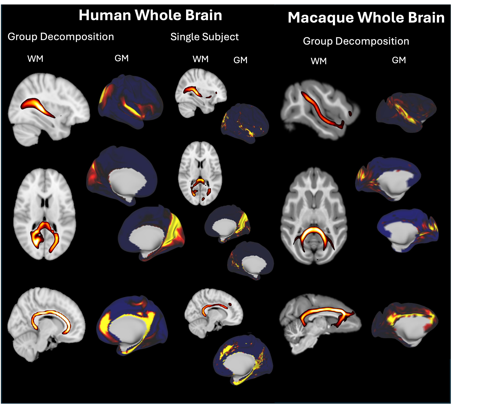

# Welcome

I am a **Clinical Neuroscientist** and a **medically trained doctor**, bringing together clinical expertise and advanced computational methods to unravel the complexities of the human brain. My research heavily utilizes computational modeling and state-of-the-art neuroimaging techniques to investigate brain function, connectivity, and structural organization.

Below is a selection of the neuroimaging modalities and techniques I work with:

  

    
  

  

    
  

  

    
  

